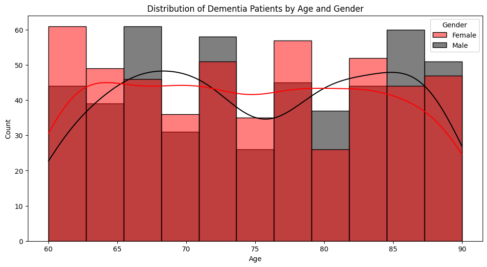
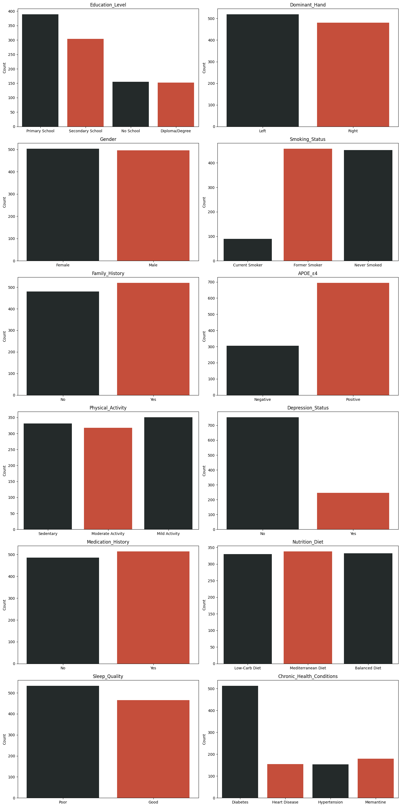

# 🧠 Personalized Dementia Prediction

<div align="center">


**A machine learning system for early-stage personalized dementia risk prediction using clinical, lifestyle, and genetic patient data.**

</div>

---

## 📋 Table of Contents

- [Overview](#-overview)
- [Dataset Features](#-dataset-features)
- [Project Pipeline](#-project-pipeline)
- [Models & Results](#-models--results)
- [Visualizations](#-visualizations)
- [Installation](#-installation)
- [Usage](#-usage)
- [Project Structure](#-project-structure)
- [Technologies Used](#-technologies-used)

---

## 🔍 Overview

Dementia is a progressive neurological disorder affecting millions worldwide. Early and accurate prediction can significantly improve patient outcomes through timely intervention. This project builds a **personalized dementia prediction model** that leverages a comprehensive set of health, lifestyle, and genetic markers to classify patients as dementia-positive or negative.

**Key Highlights:**
- 🎯 Achieved **100% accuracy** with Random Forest, Gradient Boosting, and Naive Bayes classifiers
- 🔬 Uses **17+ clinically relevant features** spanning biometrics, genetics, and lifestyle factors
- 📊 Includes extensive **Exploratory Data Analysis (EDA)** with rich visualizations
- 🤖 Compares **5 different ML algorithms** to find the best performer
- 🏥 Supports **real-time inference** via a pre-trained saved model (`dementia_model.pkl`)
- ⚖️ Handles **class imbalance** using SMOTE oversampling
- ✅ Validated with **Stratified K-Fold cross-validation** and **GridSearchCV** hyperparameter tuning

---

## 📂 Dataset Features

The dataset — `dementia_patients_health_data.csv` — contains patient records with the following features:

### 🩺 Clinical / Biometric Features

| Feature              | Description                                    | Type        |
|----------------------|------------------------------------------------|-------------|
| `Age`                | Patient age in years                           | Numerical   |
| `AlcoholLevel`       | Blood alcohol level                            | Numerical   |
| `HeartRate`          | Heart rate (bpm)                               | Numerical   |
| `BloodOxygenLevel`   | Oxygen saturation level (%)                    | Numerical   |
| `BodyTemperature`    | Body temperature (°C)                          | Numerical   |
| `Weight`             | Patient weight (kg)                            | Numerical   |
| `MRI_Delay`          | Delay in MRI scan (seconds)                    | Numerical   |
| `Diabetic`           | Whether the patient is diabetic (0/1)          | Categorical |

### 💊 Medical History & Prescriptions

| Feature                      | Description                                        | Type        |
|------------------------------|----------------------------------------------------|-------------|
| `Prescription`               | Type of medication prescribed                      | Categorical |
| `Dosage in mg`               | Medication dosage in milligrams                    | Numerical   |
| `Medication_History`         | Prior medication history (Yes/No)                  | Categorical |
| `Chronic_Health_Conditions`  | Presence of chronic conditions (Diabetes, etc.)    | Categorical |
| `Depression_Status`          | Whether patient has depression (Yes/No)            | Categorical |

### 🧬 Genetic & Lifestyle Features

| Feature             | Description                                          | Type        |
|---------------------|------------------------------------------------------|-------------|
| `APOE_e4`           | Presence of APOE e4 allele — key genetic risk factor | Categorical |
| `Family_History`    | Family history of dementia (Yes/No)                  | Categorical |
| `Smoking_Status`    | Current Smoker / Former Smoker / Never Smoked        | Categorical |
| `Physical_Activity` | Activity level (Sedentary / Mild / Moderate)         | Categorical |
| `Nutrition_Diet`    | Diet type (Low-Carb / Mediterranean / Balanced)      | Categorical |
| `Sleep_Quality`     | Sleep quality (Good / Poor)                          | Categorical |
| `Education_Level`   | Highest education level attained                     | Categorical |
| `Dominant_Hand`     | Left or Right dominant hand                          | Categorical |

### 🎯 Target Variable

| Feature    | Description                                   |
|------------|-----------------------------------------------|
| `Dementia` | Binary label — `1` (Dementia) / `0` (Healthy) |

---

## 🔄 Project Pipeline

```
Raw Dataset
    │
    ▼
Data Loading & Inspection
    │  ├── df.head(), df.describe(), df.dtypes
    │  └── df.isnull().sum()
    │
    ▼
Data Preprocessing
    │  ├── Fill missing Prescription values with mode
    │  ├── Fill missing Dosage in mg values with mean
    │  └── Fill missing Chronic_Health_Conditions with mode
    │
    ▼
Exploratory Data Analysis (EDA)
    │  ├── Count plots for categorical features
    │  ├── Histograms for continuous variables
    │  ├── Box plot for MRI_Delay
    │  └── Distribution by Age & Gender
    │
    ▼
Label Encoding (sklearn.preprocessing)
    │  └── Convert all categorical columns to numeric
    │
    ▼
Feature Selection & Train/Test Split (80/20)
    │
    ▼
Model Training & Evaluation
    │  ├── Logistic Regression
    │  ├── Random Forest Classifier  (Best)
    │  ├── Gradient Boosting Classifier
    │  ├── Support Vector Machine (SVM)
    │  └── Naive Bayes (GaussianNB)
    │
    ▼
Advanced Optimization
    │  ├── MinMaxScaler normalization
    │  ├── SMOTE oversampling for class imbalance
    │  ├── StratifiedKFold cross-validation
    │  └── GridSearchCV hyperparameter tuning
    │
    ▼
Model Persistence & Inference
       ├── Save best model → dementia_model.pkl
       └── Load model for real-time prediction
```

---

## 📊 Models & Results

| Model                    | Accuracy | Notes                                               |
|--------------------------|----------|-----------------------------------------------------|
| Logistic Regression      | **81%**  | Reasonable baseline with linear boundary            |
| Random Forest            | **100%** | ✅ Best performer — selected as final model          |
| Gradient Boosting        | **100%** | Equally strong ensemble approach                    |
| Support Vector Machine   | **47%**  | Poor performance; unsuitable for this feature space |
| Naive Bayes              | **100%** | Excellent accuracy; assumes feature independence    |

### 🏆 Final Model: Random Forest Classifier

The final model was trained using **Random Forest** with the following configuration:
- `n_estimators = 100`
- `random_state = 42`
- Optimized further with **GridSearchCV**
- Validated with **Stratified K-Fold cross-validation** to prevent data leakage

**Classification Report (Random Forest on test set):**

```
              precision    recall  f1-score   support

           0       1.00      1.00      1.00        94
           1       1.00      1.00      1.00       106

    accuracy                           1.00       200
   macro avg       1.00      1.00      1.00       200
weighted avg       1.00      1.00      1.00       200
```

---

## 📈 Visualizations

### Distribution of Dementia Patients by Age & Gender


### Categorical Feature Distributions


---

## ⚙️ Installation

### Prerequisites
- Python 3.8+
- pip

### 1. Clone the repository
```bash
git clone https://github.com/your-username/Personalized-Dementia-Prediction.git
cd Personalized-Dementia-Prediction
```

### 2. Install dependencies
```bash
pip install pandas numpy scikit-learn matplotlib seaborn imbalanced-learn joblib jupyter
```

---

## 🚀 Usage

### Option 1: Run the Full Notebook
```bash
jupyter notebook Code_Mldementianew.ipynb
```
This walks through the complete pipeline: EDA → Preprocessing → Training → Evaluation.

> **Note:** Update the dataset path in **Cell 1** to your local path before running.

---

### Option 2: Use the Pre-trained Model for Inference

```python
import joblib
import numpy as np

# Load the pre-trained model
model = joblib.load('dementia_model.pkl')

# Provide patient input features
input_features = [
    1,      # Diabetic (1 = Yes, 0 = No)
    0.085,  # Alcohol Level
    98,     # Heart Rate (bpm)
    96.2,   # Blood Oxygen Level (%)
    36.2,   # Body Temperature (degrees C)
    57.5,   # Weight (kg)
    36.4,   # MRI Delay (seconds)
    2,      # Prescription (encoded)
    9.21,   # Dosage in mg
    60,     # Age
    0,      # Smoking Status (0 = Never)
    0,      # APOE e4 (0 = Negative)
    2,      # Physical Activity (2 = Mild)
    0,      # Depression Status (0 = No)
    10,     # Cognitive Test Score
    0,      # Medication History (0 = No)
    1,      # Nutrition Diet (encoded)
    1,      # Sleep Quality (1 = Good)
    0,      # Chronic Health Conditions (0 = No)
]

input_array = np.array([input_features])
prediction = model.predict(input_array)

print("Prediction:", "Dementia Detected" if prediction[0] == 1 else "No Dementia Detected")
```

---

## 📁 Project Structure

```
Personalized-Dementia-Prediction/
│
├── Code_Mldementianew.ipynb       # Main Jupyter Notebook (full pipeline)
├── dementia_model.pkl             # Pre-trained Random Forest model
├── output.png                     # EDA: Age & Gender distribution chart
├── output1.png                    # EDA: Categorical feature distribution charts
└── README.md                      # Project documentation
```

> **Note:** The dataset (`dementia_patients_health_data.csv`) is not included in this repository. Download it from [Kaggle](https://www.kaggle.com/) and update the file path in the notebook accordingly.

---

## 🛠 Technologies Used

| Technology           | Purpose                                       |
|----------------------|-----------------------------------------------|
| **Python**           | Core programming language                     |
| **Pandas**           | Data manipulation and analysis                |
| **NumPy**            | Numerical computations                        |
| **Scikit-Learn**     | ML models, preprocessing, evaluation metrics  |
| **Imbalanced-Learn** | SMOTE for handling class imbalance            |
| **Matplotlib**       | Data visualization                            |
| **Seaborn**          | Statistical data visualization                |
| **Joblib**           | Model serialization and persistence           |
| **Jupyter Notebook** | Interactive development environment           |

---

## 🔮 Future Improvements

- [ ] Build an interactive **web dashboard** (Streamlit / Flask) for clinical use
- [ ] Incorporate **deep learning** models (LSTM, CNN on temporal data)
- [ ] Add **SHAP / LIME explainability** to identify feature importance per patient
- [ ] Expand dataset with longitudinal patient records
- [ ] Deploy model via **REST API** for hospital integration

---

## 📜 License

This project is open-source and available under the [MIT License](LICENSE).

---

<div align="center">


</div>
